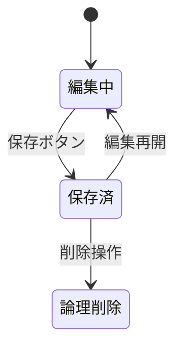

# 🛠 システム設計ドキュメントテンプレート

## 1. 🎯 システムの目的・ゴール

まず「なにをやりたいのか」を明確にする

- 本システムの役割は何か？
- どのような課題を解決するのか？
- ユーザーのどんな行動・体験に影響するのか？

---

## 2. 🧭 全体構成・利用フロー

- システムの全体像を簡潔に記述（図があるとベター）
- 処理や画面遷移などの流れ
- システム構成図、画面遷移図（あれば）

---

## 3. 🔍 ユースケース / シナリオ

### 3.1 ユースケース一覧

| No  | ユースケース名     | 説明                                             | 主なアクター     |
| --- | ------------------ | ------------------------------------------------ | ---------------- |
| 1   | データの保存       | フォームの入力値を保存                           | 一般ユーザ       |
| 2   | 添付ファイルの追加 | Cloud Storage に保存し、Firestore にメタ情報追加 | 管理者アカウント |

### 3.2 詳細パターン（観点ごと）

- 別タブでの操作時
- 長時間放置後の保存
- 通信切断時
- 異なるブラウザ間の違い
- 操作直後にページ遷移した場合　など

---

## 4. 🔄 状態遷移表・遷移図

### 状態一覧と定義

| 状態     | 説明                          |
| -------- | ----------------------------- |
| 編集中   | フォームを操作中              |
| 保存済   | Firestore にデータ反映済      |
| 論理削除 | UI 上では非表示だが、履歴保持 |

### 遷移イベント

状態遷移表で整理

| 現在の状態 | イベント | 遷移後の状態 | 備考               |
| ---------- | -------- | ------------ | ------------------ |
| 編集中     | 保存     | 保存済       | タイムスタンプ更新 |

※ 状態遷移図は Mermaid.js などで描くと便利です



---

## 5. 🧠 設計方針・構成判断理由

- なぜその設計を選んだのか？自分の言葉で説明してみる
- 他の選択肢を採用しなかった理由
- AI になぜそうしたか AI に質問
  - 例）今後は辛口かつフラットな視点で答えて。設計に関する場合「この場合はどうしますか」と付け加えて
- 整合性 / 拡張性 / UX など、どの観点を優先したか

### 比較表（例）

| 案   | 説明                   | メリット         | デメリット       | 採用可否 |
| ---- | ---------------------- | ---------------- | ---------------- | -------- |
| A 案 | クライアントで状態管理 | パフォーマンス高 | 整合性取りづらい | 不採用   |
| B 案 | Firestore 主導         | 一貫性 ◎         | 通信負荷あり     | 採用     |

---

## 6. ⚖ トレードオフと今後の課題

- 今の設計の限界
- 今後必要になるであろう改善ポイント
- 後続のタスクにつなげるヒント

---

## 7. 📄 補足資料・関連リンク

- 外部サービスとの連携仕様
- API ドキュメント
- データ構造スキーマ図
- 関連チケット・議論 URL

---

## 8. 🕘 設計決定履歴（ADR: Architecture Decision Record）

| 日付       | 決定事項                 | 理由                   | 影響範囲                         |
| ---------- | ------------------------ | ---------------------- | -------------------------------- |
| 2025-05-23 | Firestore 主導の保存設計 | マルチタブ整合性の担保 | クライアント保存ロジック全面変更 |

---

```

---

### 🔧 利用方法アドバイス
- 各章は**Notion**や**docフォルダ内のMarkdown**として分割してもOK
- 共同開発時はPull Requestでレビューを通して更新
- 過去設計との差分追跡のためにGit管理を推奨

```
